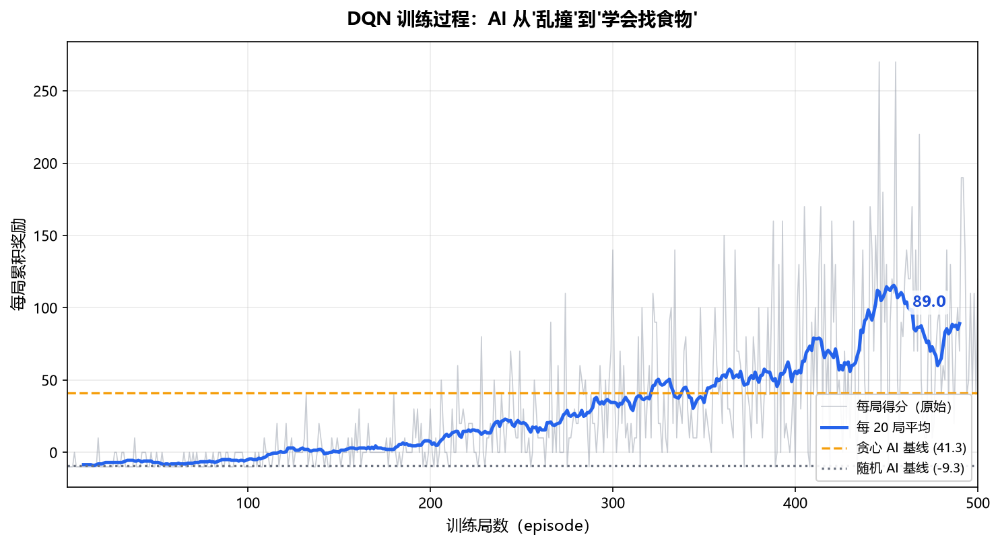
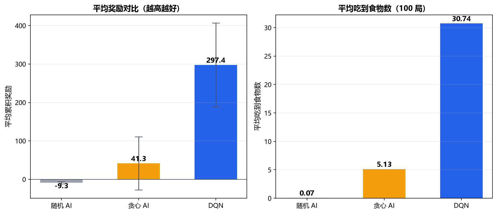

# 贪吃蛇 AI（Snake AI）

> 用**深度强化学习（DQN）**训练一个 AI，让它从"完全不会玩贪吃蛇"到"自己学会吃食物、避开障碍、越玩越强"。

这是我在《人工智能导论》课程中的个人项目。我会用 GitHub 完整记录整个学习过程，从零开始，循序渐进地展示 AI 是如何一步步"学会"玩游戏的。

---

## 🎯 项目目标

1. 用 Python + pygame 实现一个可玩的贪吃蛇游戏。
2. 理解强化学习的核心概念（状态、动作、奖励、Q 值）。
3. 用 PyTorch 亲手实现 DQN 算法，训练 AI 自主学会玩游戏。
4. 通过实验对比和调参，让 AI 的得分不断提升。
5. 完整记录学习过程，形成清晰的技术成长轨迹。

## 🧠 为什么选这个题目

强化学习是人工智能中最直观、最有冲击力的方向之一。看一个 AI 从"笨拙地乱撞"到"熟练地吃食物、避开障碍"，这个过程本身就是"机器学习"最生动的体现。相比直接调用现成的 AI 库，亲手实现算法能让我真正理解其中的原理。

## 🛠 技术栈

| 模块 | 技术 |
|---|---|
| 语言 | Python 3.10+ |
| 游戏环境 | pygame |
| 深度学习 | PyTorch |
| 算法 | DQN（深度 Q 学习） |
| 可视化 | matplotlib |

## 📅 学习路线（每周一个里程碑）

- [x] **第 1 周**：环境搭建 + Git/GitHub 入门
- [x] **第 2 周**：写出"人能玩的贪吃蛇"
- [x] **第 3 周**：强化学习基础 + 游戏"数据化"
- [x] **第 4 周**：实现最简单 AI（随机版 / 规则版）
- [x] **第 5 周**：神经网络（Q 网络）+ 理解 Q 学习
- [x] **第 6 周**：实现 DQN 核心算法
- [x] **第 7 周**：训练可视化 + AI 现场演示 + 三种 AI 对比
- [ ] 第 8 周：调参优化 + 实验对比
- [ ] 第 9 周：录制 Demo 视频 + 项目整理
- [ ] 第 10 周：报告 + 答辩准备

## 📁 项目结构

```
snake-ai/
├── README.md          # 项目说明
├── game.py            # 贪吃蛇游戏核心（第 2 周）
├── env.py             # 标准强化学习环境（第 3 周）
├── baseline.py        # 随机 AI / 贪心 AI 基线（第 4 周）
├── model.py           # Q 网络结构（第 5 周）
├── agent.py           # DQN 智能体：经验回放 + 目标网络 + ε-greedy（第 6 周）
├── train.py           # 训练脚本（第 6 周）
├── plot_results.py    # 训练曲线可视化（第 7 周）
├── play.py            # AI 现场演示（第 7 周）
├── compare.py         # 三种 AI 对比实验（第 7 周）
├── model/             # 保存的训练模型（.gitignore 已排除）
├── results/           # 训练曲线、对比图表、得分数据
└── report/            # 期末报告
```

## 🚀 运行方法

### 1. 安装依赖

```bash
python -m pip install pygame numpy torch matplotlib
```

> 国内下载慢的话，加清华镜像源：`-i https://pypi.tuna.tsinghua.edu.cn/simple`

### 2. 自己玩（第 2 周成果）

```bash
python game.py
```

操作：方向键 ↑ ↓ ← → 控制蛇移动，按 ESC 退出，死亡后按 R 重新开始。

### 3. 训练 AI（第 6 周成果）

```bash
python train.py
```

500 局大约需要 1~3 分钟（CPU 即可，不需要 GPU），训练中会实时打印得分和 ε 变化。

### 4. 看训练曲线（第 7 周成果）

```bash
python plot_results.py
```

生成 `results/training_curve.png`，并打印各阶段统计数据。

### 5. 看 AI 现场玩游戏（第 7 周成果）

```bash
python play.py              # 看训练好的 DQN 玩
python play.py greedy       # 看贪心 AI 玩（对比用）
python play.py random       # 看随机 AI 玩（最笨的）
python play.py dqn 30       # 速度设为 30 帧/秒
```

操作：空格暂停 / R 重开 / `+` `-` 调速 / ESC 退出。

### 6. 三种 AI 对比实验（第 7 周成果）

```bash
python compare.py
```

在相同随机种子下各测 100 局，输出对比表格和 `results/comparison.png`。

## 📈 训练结果

训练 500 局后，AI 的平均奖励从 **-7.2** 提升到 **87.8**，明显超过贪心 AI 的基线水平（第 4 周实测 49.1，第 7 周受控复测 41.3）。

> 注意：87.8 是**训练末期**的成绩，此时 ε 仍有 0.082 的随机探索噪声。关闭探索（ε=0）后，AI 的真实水平是 **297.4**，详见下方「三种 AI 对比」。



| 训练阶段 | 平均奖励 |
|---|---|
| 第 1-50 局 | -7.2 |
| 第 101-150 局 | -0.2 |
| 第 201-250 局 | 15.6 |
| 第 301-350 局 | 38.0 |
| 第 401-450 局 | 81.0 |
| 第 451-500 局 | **87.8** |

曲线可以清楚看到 AI 学习的三个阶段：

1. **第 1~100 局**：几乎不进食，分数在 0 以下徘徊 —— 这个阶段 AI 主要在"乱试"，靠随机探索积累经验。
2. **第 100~350 局**：稳定爬升，逐渐超过 0 并追上贪心 AI —— 它开始理解"朝食物走"能拿分。
3. **第 350~500 局**：快速拉升并稳定在 80 以上，反超贪心 AI —— 它学会了在变长的同时避开自己的身体。

> Demo 视频将在第 9 周补充。

### 为什么评测得分（297.4）比训练时（87.8）高这么多？

这是强化学习里一个很容易被误解的现象，值得单独说明：

训练时 ε（随机探索概率）衰减到 **0.082** 左右，也就是说**每 12 步就有 1 步是完全随机乱走**。短蛇时无所谓，但当蛇长到 30 节以上，任何一次随机拐弯几乎必然撞到自己。所以**训练末期的得分是被探索噪声严重压低的**。

评测时（`compare.py` / `play.py`）把 ε 设为 **0**，AI 每一步都选 Q 值最大的动作，没有任何随机性——这才是它的**真实水平**。

| | ε（探索概率） | 平均奖励 |
|---|---|---|
| 训练末期（第 451-500 局） | 0.082 | 87.8 |
| 正式评测（ε=0） | 0.000 | **297.4** |

> 结论：训练日志里的分数是"带着干扰练习的成绩"，评测分数才是"考试真实成绩"。报告里必须说清这个区别，否则会被质疑数据不一致。

## 🥊 三种 AI 对比

在**相同随机种子**（同一批食物位置序列）下，三种 AI 各玩 100 局：



| AI | 平均奖励 | 标准差 | 平均吃到食物 | 最好一局 |
|---|---|---|---|---|
| 随机 AI | -9.3 | 2.6 | 0.07 | 1 |
| 贪心 AI | 41.3 | 68.9 | 5.13 | 23 |
| **DQN** | **297.4** | 109.2 | **30.74** | **57** |

三个结论：

1. **DQN 是贪心 AI 的 7.2 倍**（297.4 vs 41.3），平均每局能吃 30 个食物。
2. **贪心 AI 的标准差极大（68.9）**，说明它极不稳定——运气好时能吃到 23 个，运气差时 0 个就撞死。它只看目标不看危险，蛇一长就必然撞自己。
3. **DQN 的下限很高**（最差一局也吃到 9 个），说明它不是靠运气，而是**真的掌握了策略**——这是"学会"和"碰巧"的本质区别。

---

## 📝 学习日志

每周完成后，我会在这里记录学习心得。

### 第 1 周（2026-11-13）

- **本周做了什么**：确定项目方向（贪吃蛇 AI / 强化学习），搭建项目结构，完成环境配置。
- **遇到的问题**：Windows 系统未安装 Git；HTTPS 直连 GitHub 被阻断。
- **怎么解决的**：安装 Git for Windows；改用 SSH 方式推送（配置 SSH 密钥）。
- **下周计划**：用 pygame 写出能手动玩的贪吃蛇游戏。

### 第 2 周（2026-11-13）

- **本周做了什么**：用 pygame 实现了可手动玩的贪吃蛇，包含游戏循环、方向控制、吃食物变长、撞墙/撞自己判定、计分。
- **核心理解**：
  - 贪吃蛇本质是一个「网格游戏」，蛇 = 坐标列表，食物 = 坐标，方向 = 向量。
  - 游戏分为三层：`SnakeGame`（规则/状态）、`draw_game`（渲染）、`main`（循环调度）。
  - `step(action)` 函数返回（新状态、奖励、是否结束），这是后续接入强化学习的核心接口。
- **遇到的问题**：pygame 2.6.1 在 Python 3.13 下 `SysFont` 扫描系统字体时报错。
- **怎么解决的**：改用 `pygame.font.Font(None, ...)` 默认字体。
- **下周计划**：理解强化学习基础概念（状态/动作/奖励），把游戏改造成 AI 可调用的环境。

### 第 3 周（2026-11-13）

- **本周做了什么**：理解强化学习核心概念，把贪吃蛇封装成标准 RL 环境（`env.py`）。
- **核心理解**：
  - 强化学习 = 智能体与环境不断交互的循环：看状态 → 选动作 → 拿奖励。
  - 用贪吃蛇对照：智能体=DQN 网络，环境=SnakeGame，状态=局面，动作=方向，奖励=得分。
  - 回合（Episode）= 一局游戏；回报（Return）= 一局的累积奖励。
- **关键设计**：
  - 状态用 **11 个数字**表示（方向 4 + 食物方位 4 + 危险 3），采用 one-hot 编码，比整张棋盘更精简、训练更快。
  - 动作从方向向量改为 **0/1/2/3 编号**，对应神经网络输出的 4 个 Q 值。
  - **奖励设计**：把普通移动从 -1 改为 0，避免 AI 因害怕惩罚而学会"消极策略"（早死早结束）。
- **遇到的问题**：无（概念理解为主）。
- **下周计划**：实现随机 AI 和贪心 AI 两个 baseline，跑通训练循环框架。

### 第 4 周（2026-11-13）

- **本周做了什么**：实现随机 AI 和贪心 AI 两个 baseline，跑通训练循环框架（`baseline.py`）。
- **实验结果**（各玩 100 局）：
  - 随机 AI 平均得分：**-9.30**（纯碰运气，很快死）
  - 贪心 AI 平均得分：**49.10**（只看食物方向、不看危险）
- **核心理解**：
  - baseline 的意义：有对比才有说服力，DQN 需要显著超越这两个参照物。
  - 训练循环的雏形：`reset → 循环 step → done`，和后面 DQN 训练结构完全一致。
  - 意外发现：贪心 AI 得分很高（49.10），因为 20×20 棋盘空间大，前期不易撞自己；但它天花板低，学不会避障，蛇身变长后必死。
- **遇到的问题**：代码中字符串嵌套中文双引号导致 `SyntaxError`。
- **怎么解决的**：将内层引号改为单引号，避免与外层双引号冲突。
- **下周计划**：搭建神经网络（Q 网络），理解 Q 学习和 Q 值的概念。

### 第 5 周（2026-11-14）

- **本周做了什么**：用 PyTorch 搭建 Q 网络（`model.py`），理解神经网络和 Q 学习的概念。
- **核心理解**：
  - 为什么需要神经网络：贪吃蛇局面太多，无法用 Q 表穷举，需要神经网络"学会规律"而非"死记硬背"。
  - Q 值 = 某个局面下做某个动作，"长期来看"能得多少分。
  - 神经网络结构：输入层(11) → 隐藏层(128) → 隐藏层(128) → 输出层(4)，ReLU 提供非线性。
  - AI 决策 = 选 Q 值最大的动作。
- **遇到的问题**：PyTorch 加载 DLL 失败（WinError 126，缺 VC++ 运行库）；torch 下载慢。
- **怎么解决的**：用清华镜像源加速安装；安装 VC++ 运行库后恢复正常。
- **下周计划**：实现 DQN 核心算法（经验回放、目标网络、ε-greedy 探索）。

### 第 6 周（2026-11-14）

- **本周做了什么**：实现完整的 DQN 算法（`agent.py`）和训练脚本（`train.py`），并完成了第一次训练。
- **DQN 三大组件**：
  - **经验回放**：存 10000 条经历，每次随机抽 64 条训练，打破样本相关性。
  - **目标网络**：用参数冻结的 target 网络计算学习目标，每 100 步同步一次，避免"追自己的影子"。
  - **ε-greedy**：ε 从 1.0 衰减到 0.05，前期充分探索，后期主要利用。
- **贝尔曼方程**：`Q(s,a) = r + γ × max Q(s',a')`，用 smooth_l1_loss 计算误差，梯度裁剪防止爆炸。
- **训练结果**（500 局，每局上限 200 步无进食）：

  | 训练阶段 | 平均奖励 |
  |---|---|
  | 第 1-50 局 | -7.2 |
  | 第 101-150 局 | -0.2 |
  | 第 201-250 局 | 15.6 |
  | 第 301-350 局 | 38.0 |
  | 第 401-450 局 | 81.0 |
  | 第 451-500 局 | **87.8** |

- **关键发现**：
  - AI 的学习呈现清晰的三个阶段：先学"怎么不死"（负分转 0）→ 再学"主动找食物"（0 到 40）→ 最终稳定在高位（80+）。
  - 最终成绩 **87.8** 远超贪心 AI 的 49.1，证明 DQN 真正学会了"既吃食物、又避开危险"。
  - 历史单局最高 270 分。
- **遇到的问题**：无（训练一次成功）。
- **下周计划**：把得分曲线画成图，做正式的可视化展示。

### 第 7 周（2026-11-14）

- **本周做了什么**：把训练成果做成可视化和可演示的东西，新增三个脚本：
  - `plot_results.py` —— 读取 `scores.npy`，画出带滑动平均的训练曲线，并标出两条 baseline 虚线。
  - `play.py` —— 加载训练好的模型，用 pygame 实时演示 AI 玩游戏，支持暂停、调速、切换三种 AI。
  - `compare.py` —— 三种 AI 在相同随机种子下各测 100 局，输出对比表格和柱状图。
- **实验结果**（相同随机种子，每种各 100 局）：

  | AI | 平均奖励 | 标准差 | 平均吃到食物 |
  |---|---|---|---|
  | 随机 AI | -9.3 | 2.6 | 0.07 |
  | 贪心 AI | 41.3 | 68.9 | 5.13 |
  | **DQN** | **297.4** | 109.2 | **30.74** |

- **核心理解**：
  - **原始曲线抖动是正常的**：单局得分的方差很大（-10 到 270 都出现过），所以必须用滑动平均（每 20 局取平均）才能看清"趋势"，否则容易被毛刺误导。
  - **ε 会造成"训练分"和"评测分"的巨大差异**：训练末期 ε≈0.082，即每 12 步就有 1 步随机乱走，蛇一长这种随机拐弯几乎必然撞死，所以训练日志只有 87.8；评测时 ε=0，真实水平是 297.4。报告里必须说明这个区别，否则会被质疑数据不一致。
  - **误差棒（标准差）比平均值更说明问题**：贪心 AI 标准差 68.9（最高 23 个食物、最差 0 个），说明它极不稳定；DQN 最差一局也能吃到 9 个，下限很高，说明它靠的是策略而不是运气。
  - **对比实验要控制变量**：`compare.py` 固定随机种子，让三种 AI 面对同一批食物位置序列，否则"运气好"会被误当成"能力强"。
  - **演示比数字更有说服力**：先放随机 AI 乱撞、再放 DQN 稳稳吃，观众 5 秒就能感受到差距。
- **遇到的问题**：matplotlib 默认字体不含中文，图表里中文会显示成方块（豆腐块）。
- **怎么解决的**：先检测系统里有没有中文字体（微软雅黑 / 黑体），有就设置 `font.sans-serif`，没有就自动退回英文标签——保证脚本在任何机器上都不会输出乱码。
- **下周计划**：做调参实验（学习率、γ、网络结构），用数据说明超参数对训练效果的影响。
